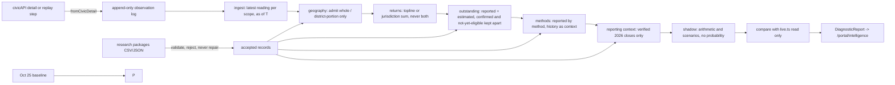

# Election-night intelligence engine: Phase 1

Branch `feature/election-night-intelligence-v1`. Baseline commit `44d06d08e0268bd0fb6d4fb17bb96571933eb8b8`. Election date: November 3, 2026.

> **This is a working software architecture. It is not a validated election forecasting model.** Nothing here has a
> backtest, so it gives no win probability and calls no races. All test fixtures are SYNTHETIC. The shadow engine runs
> next to the published engine and publishes nothing.

## 1. Audit of the existing system

| Area | What exists | What it means for Phase 1 |
|---|---|---|
| Published Nov 3 engine | `app/results/2026/live.ts`: `project()`, `liveOdds()`, `sides()`, `matchCivic()`. Pure functions. | Reused **read only**. The shadow engine imports these functions to compare against them. It never changes them. |
| Fraction counted | `project()` uses a county's `pr` (percent of **precincts** reporting) as the share of that county's votes counted. | This is the issue the brief warns about. Phase 1 records precinct percentages as metadata only. On civicAPI test data for `sen-GA`, the published engine shows **100% in** while the shadow shows **88.5%** of the forecast's expected total. Changing `project()` needs approval (see §8). |
| Vote-mode model | `app/results/_lib/voteModeModel.ts` uses illustrative placeholder weights. | Not reused. Phase 1 makes no partisan assumption about any voting method. |
| County-to-district crosswalk | None in the repo. | House races do not use county-level figures unless the source reports the district portion. Split counties are never allocated whole. |
| House expected votes | `public/results/2026/st/*.json` holds county expectations for statewide races only. | House races have only the forecast's district total (`index.json` `tot`). |
| Live source | civicAPI, through `/api/civic/search` and `/api/civic/race/[id]`. Provides FIPS-keyed regions, `pr`, `updated` and `test`. No breakdown by voting method. | Every live vote is method `UNKNOWN`, and stays that way until a source provides the method. |
| Forecast snapshot of Oct 25 | `public/forecast/model.json` (meta.updated 2026-10-25) and `public/forecast/archive/2026-10-25.json`. The archive contains bare `NaN` (invalid JSON) and has no House races. | The baseline comes from `model.json` at the pinned commit. The archive is used to cross-check the 71 statewide races: 0 mismatches. |
| Portal protection | `middleware.ts` gates `/portal/*` with a signed cookie (`app/lib/portalSession.ts`). `app/portal/layout.tsx` sets noindex. `/api/portal*` is **not** in the matcher. | The diagnostics page lives under `/portal/` and checks the session again itself. No API route was added, so the middleware was not changed. |

## 2. Design



- Each stage runs inside a try/catch (`run()` in `pipeline.ts`). If a stage throws, it is marked `FAILED` and every later stage is marked `UNAVAILABLE`. The pipeline itself never throws and writes nothing.
- Snapshots are taken at a point in time. `latestReadings(log, raceId, asOf)` ignores anything later than `asOf`. If a reading has no source timestamp, it is ordered by retrieval time and flagged.
- Raw data is kept. Each logged observation carries its raw payload, and the log only ever grows.
- Votes are not double counted. A topline is never added to its own counties. A method breakdown is never added to the same county's total. Statewide and county statements of outstanding ballots are never summed.
- Confidence is `NONE` if any stage failed or the shadow is unavailable. It is `LOW` if any input is estimated, unquantified or missing, and `MEDIUM` only when every input is VERIFIED and complete. `HIGH` is never reached, because it needs a backtest.

## 3. Modules

| Module (brief) | File | Status |
|---|---|---|
| A. Reporting intelligence | `app/lib/intelligence/composition.ts` (`reportingContext`) | **Implemented.** Only VERIFIED 2026 poll-closing times are treated as closing times. Historical reporting windows are shown as context and flagged `windowsAreHistoricalContextOnly: true`. |
| B. Outstanding vote | `app/lib/intelligence/outstanding.ts` | **Implemented.** Expected final = reported + estimated outstanding, as an interval. Officially confirmed outstanding, not-yet-eligible and unknown inventory are kept as separate fields. A turnout figure with no stated range gives `UNQUANTIFIED`; no range is invented for it. |
| C. Geography | `app/lib/intelligence/geography.ts` | **Implemented.** A whole county is admitted only for statewide races, at-large seats, or when it lies entirely (weight ≥ 0.999) inside the district. A split county counts only when the source reports the district portion. A weight-based figure is shown as an estimate and never added to the reported count. |
| D. Voting method | `app/lib/intelligence/composition.ts` (`composeMethods`) | **Implemented.** Reports votes by method and the history behind them. An unknown method stays `UNKNOWN`. Remaining vote by method is `UNAVAILABLE`. |
| E. Shadow projection | `app/lib/intelligence/shadow.ts`, `published.ts` | **Implemented, limited to arithmetic.** It reports the share counted, what share of the outstanding vote the trailing side needs, whether the lead exceeds the high end of outstanding, and two transparent scenarios (outstanding splits like the reported vote; outstanding splits like the forecast). Win probability is `UNAVAILABLE`. |

### Supporting files

| File | Purpose |
|---|---|
| `app/lib/intelligence/types.ts` | Typed contracts: evidence classes, provenance, record types, stage results, and the report. |
| `app/lib/intelligence/research.ts` | Imports and validates CSV and JSON research packages. Bad records are rejected, never repaired. |
| `app/lib/intelligence/baseline.ts` | Oct 25 baseline, archive cross-check, Top-N register, research coverage, and a NaN-tolerant JSON parser. |
| `app/lib/intelligence/observations.ts` | Append-only log, latest readings, totals, and the civicAPI adapter. |
| `app/lib/intelligence/pipeline.ts` | Stage runner, missing inputs, confidence. |
| `app/lib/intelligence/replay.ts` | Replays a sequence of logs through the pipeline. A synthetic replay is marked `backtestEligible: false`. |
| `app/lib/intelligence/load.ts` | Loads `data/intelligence/research/`. Refuses synthetic packages. |
| `app/portal/intelligence/*` | Protected diagnostics page (server component). |
| `scripts/intelligence/*` | Register builder, package validator, and the Node TypeScript resolve hook. |
| `data/intelligence/baseline/2026-10-25.json` | 506 races from `model.json` at the pinned commit. |
| `data/intelligence/register/top50-2026-10-25.json` | The Top 50: 8 Senate, 5 governor, 37 House. The widest margin is 3.63 points. Each source file carries its git ref and sha256. |
| `data/intelligence/research/` | Drop folder for research, with `README.md` and templates. Currently empty, so all research shows as missing. |
| `tests/intelligence/*` | 61 tests, all on SYNTHETIC fixtures except the register check against the pinned files. |

## 4. Provenance contract

Every research record has these fields:

- `record_id`, `record_type`, `race_id` (empty means the whole state), `state`
- `jurisdiction_id`, `jurisdiction_level`, `method`
- `evidence_class`, `value_kind` (OBSERVATION or ESTIMATE)
- `source_url`, `source_name`, `published_at`, `retrieved_at`
- `historical_year`, `confidence`, the reporting window, `limitations`, `notes`

The full column list, the rules for each evidence class and each record type, are in `data/intelligence/research/README.md`.

| Class | Rule |
|---|---|
| VERIFIED | Needs a source URL and a retrieval time. Must be about 2026. |
| HISTORICAL | Needs a source URL and a retrieval time. The year must be before 2026, and the value must be an OBSERVATION. |
| INFERRED | Must be an ESTIMATE and must state its basis. |
| UNKNOWN | Carries no value. Confidence is NONE. |

Other checks reject or flag:

- unmatched race ids
- future retrieval times, and a publication date later than the retrieval time
- a historical poll close (warned as not applicable to 2026)
- single-number turnout expectations
- statements of outstanding ballots that are not VERIFIED
- malformed district ids
- duplicate record ids
- county splits whose weights add up to more than 1 (every split for that county is excluded)

## 5. Implemented vs awaiting research

| Capability | Status | What unblocks it |
|---|---|---|
| Top 50 register and the baseline | Done. Built from pinned files. | n/a |
| Research import, validation and coverage | Done | Research packages in `data/intelligence/research/` |
| Live civicAPI ingestion (topline and counties) | Done. Test data is excluded unless explicitly admitted. | n/a |
| Statewide geography | Done | n/a |
| House geography for split counties | **Awaiting research.** No crosswalk exists. | `GEO_SPLIT` records with a stated weight basis, or a source that reports district portions |
| Turnout interval | **Awaiting research.** Today it falls back to the forecast's expected total as an unquantified point. | `TURNOUT_EXPECTATION` records with a low and a high |
| Official outstanding ballots | **Awaiting research and live statements** | VERIFIED `OUTSTANDING_REPORT` records |
| Poll closes and reporting windows | **Awaiting research** | VERIFIED 2026 `POLL_CLOSE`; HISTORICAL `REPORTING_WINDOW` |
| Method composition | Reported side done. Live source has no methods. | `METHOD_HISTORY` research; a live source that breaks out method |
| Remaining vote by method | **Unavailable by design** | A defensible, backtested method model |
| Win probability | **Unavailable by design** | An outstanding-vote error model backtested on timestamped historical returns |
| Backtests | **None.** Synthetic replays are software tests only. | Timestamped historical return archives |

## 6. Run and validate

```bash
npm run test:intelligence                # 61 tests, about 2 s
npm run intelligence:register            # rebuilds baseline + register from the pinned commit (git show)
npm run intelligence:validate -- data/intelligence/research/<file>.json
npm run intelligence:validate -- data/intelligence/research/<file>.csv   # needs <file>.meta.json beside it
npx tsc --noEmit                         # only the pre-existing .next/dev/types errors remain
npx eslint app/lib/intelligence app/portal/intelligence scripts/intelligence tests/intelligence
```

Diagnostics page, after signing in to the portal:

| URL | Shows |
|---|---|
| `/portal/intelligence` | The register, research coverage, shadow status, confidence, and the number of gaps per race |
| `/portal/intelligence?race=sen-GA` | One race, forecast and research only |
| `/portal/intelligence?race=sen-GA&live=1` | Adds civicAPI returns. Test data is excluded. |
| `/portal/intelligence?race=sen-GA&live=1&test=1` | Admits civicAPI test data, with a TEST banner |

The scripts run TypeScript directly on Node 24, using type stripping and `scripts/intelligence/ts-resolve.mjs`. No new dependencies were added.

## 7. Changed files

- **Modified:** `package.json` (three scripts added).
- **Added:**
  - `app/lib/intelligence/*`
  - `app/portal/intelligence/*`
  - `scripts/intelligence/*`
  - `data/intelligence/*`
  - `tests/intelligence/*`
  - this document
- **Untouched:** the dashboard, forecast, polling, historical data, `/play`, styling, race-call logic, `live.ts`, the middleware, `tsconfig.json` and `next.config.ts`.

## 8. Architectural conflicts that need approval

1. **The published engine treats precincts reporting as votes counted.** `project()` in `live.ts` uses county `pr` as the fraction counted. The shadow engine shows the gap (100% vs 88.5% on `sen-GA` test data). Changing `project()` would change published numbers, so it is out of scope until approved.
2. **No county-to-district crosswalk.** House shadow figures stay `PARTIAL` until a crosswalk source is approved. Options include Census block-level relationship files, or state-reported district-portion results.
3. **`voteModeModel.ts` placeholder weights.** These are illustrative partisan weights. Phase 1 ignores them. Whether they should remain anywhere public needs a decision.
4. **Win probability.** Any probability for the shadow engine needs a backtest on timestamped historical returns. The repo has none. Neither does civicAPI, as far as the audit found.
5. **Research directory in deployment.** `load.ts` reads `data/intelligence/research/` at request time. If the page is ever deployed, confirm that the folder is included in the server bundle (Next.js output file tracing), or move it to storage. Not deployed in Phase 1.
6. **API access.** Any future `/api/...` route for the engine must be added to the middleware matcher, or protected some other way, before it exists. None was added.
7. **`package.json` scripts.** Three npm scripts were added. They have no effect on the build or deployment.
