# Election Night — Individual Race Experience v1

Branch: `ui/election-night-race-v1`
Companion: [ELECTION_NIGHT_MAIN_INTEGRATION.md](ELECTION_NIGHT_MAIN_INTEGRATION.md) (how `origin/main` was folded in first)
Scope: `app/results/2026/[race]` — the per-race page that sits below the national dashboard shipped in [ELECTION_NIGHT_DASHBOARD_V1.md](ELECTION_NIGHT_DASHBOARD_V1.md).

## 1. Integration status

- Base: dashboard head `5849d80b` + `origin/main` `30ecde03` → merge `38eda28f` (no conflicts, zero overlapping files).
- Lester's forecast refresh (`model.json` meta.updated 2026-10-28, archive `2026-10-28.json`, `public/forecast/**`, `public/results/2026/index.json` with `asOf: "2026-10-28"`) is the data this page reads. Nothing in `app/forecast/**`, `app/lib/**`, or the forecast JSON was edited.
- The protected branch `feature/election-night-intelligence-v1` (`0559aad3`) was not touched. Its one local artefact in the working tree (an uncommitted edit to `app/api/flightrecorder/[raceId]/route.ts` that imports modules which only exist on that branch) broke `next build`; it was patched out to `~/research/racev1/preserve/` for the build and restored afterwards. It is not part of this commit.

## 2. What changed, file by file

Only one application file changed:

| File | Change |
|---|---|
| `app/results/2026/NightDesk.tsx` | Race-page renderer. Every change below lives here, including its CSS block (`ND_CSS`). |
| `docs/ELECTION_NIGHT_MAIN_INTEGRATION.md` | New. Integration record. |
| `docs/ELECTION_NIGHT_RACE_EXPERIENCE_V1.md` | New. This file. |
| `docs/audit-screenshots/election-night-race-v1/**` | New. Screenshot evidence + `report.json`. |

Untouched on purpose: `live.ts` (projection math, `liveOdds`, `project`, `expMargin`, `expSides`), `useLive.ts`, `CallBand.tsx`, `callStatus.ts`, `NationalDesk.tsx`, `StateDesk.tsx`, `page.tsx` routes, the civic proxy, and all forecast/result JSON.

## 3. Components and tokens reused (not rebuilt)

- `CallBand` + `callStatus.css` for the race-status band and the `.topline-lead.won/.proj` chips (projection chip keeps its dashed border so a projection never reads as a call).
- `DESK_CSS` from the dashboard for header, meta blocks, tabs, tables, map legend, `.live-dot`.
- `marginColor` / `marginColorInd` (`app/lib/forecastColors`) for every county fill; `--dem/--gop/--ind/--gold/--win` tokens; light theme through `html[data-theme="light"]`.
- `live.ts`: `project()`, `liveOdds()`, `expMargin()`, `expSides()`, `fmtM()`, `legDistricts()`, `forecastHref()`.
- `FloatTip` county hover, the national map's hatch grammar (reused as the "expected lean, no votes yet" pattern on the race map).

## 4. Visual and information improvements

Reading order on the page is now: where am I → what is the state of this race → who is leading and by how much → how does that compare with the forecast → the county picture → how to read it.

1. **Breadcrumb** (`.nd-crumbs`): Election night / category hub / state page / race. Hidden when the desk is embedded in a state page.
2. **Forecast date comes from data.** The kicker and the Method section read `ix.asOf` ("Forecast of October 28") instead of a hand-typed date, so Lester's next refresh re-labels the page automatically.
3. **Status pill** (`.nd-status.s-*`): eight explicit keys — connecting, feed unreachable, awaiting feed, polls open, awaiting returns, counting (live dot), OnPoint Projection (live dot), race called. Each key has its own colour so the state is readable before the words are.
4. **Meta row reordered**: Race status → Reported votes → Estimated reporting → civicAPI reporting → Pre-election forecast → Last updated. The forecast block shows margin + favourite probability (`D+4.1 · 71%`), `D 54%` for legislative chambers, "Toss-up" inside ±0.05, or "None" when no forecast exists for the race.
5. **Candidate rows**: leader row highlighted, winner row filled; each row shows "· forecast xx.x%" (expected share) and a tick on the bar at that share so over/under-performance is visible at a glance. Badges: *Called by civicAPI*, *OnPoint projection*, *Leads by N votes*, *Forecast favorite* / *Favored to pass / fail*.
6. **No-forecast gating.** Races without a published forecast (most `other`/`state` rows, some measures) no longer show a projection dial, estimated reporting, or any projection badge; they get a short `.nd-nofc` panel explaining that returns are shown raw. `projected` now requires `hasFc` — the page cannot project a race it has no prior for.
7. **Results map has three readings**: *Margin* (default; opacity tracks share reporting), *Vs expected* (shaded toward whichever side beats its forecast margin), *Reporting* (gold ramp by % in). Counties with nothing in render their expected lean hatched, mirroring the national map. Caption and legend change with the mode.
8. **Links**: every race page reaches its state page ("Every Georgia result"), the national dashboard, the forecast page and the situation monitor from the tab row.
9. **Error honesty**: `live.error` is surfaced in the header when there is no feed, and the status reads "Live returns unreachable" rather than silently "Awaiting".
10. **Method and sources** rewritten with the live date, links to the national dashboard and forecast methodology.
11. A commented anchor `#nd-history` sits below the projection zone for the Race History module that will arrive from `feature/election-night-intelligence-v1`.

## 5. Race types covered

| Kind | Example route | Forecast prior | Notes |
|---|---|---|---|
| Senate | `/results/2026/sen-GA` | yes | flagship; all 14 states below |
| Governor | `/results/2026/gov-GA` | yes | same renderer; close-race scenario captured here |
| House | `/results/2026/house-GA-05` | yes | single district; county map limited to district counties |
| Ballot measure | `/results/2026/bm-CA-proposition-40` | yes (`pPass`) | Yes/No palette, "Favored to pass/fail" |
| State executive | `/results/2026/agri-GA` | yes | |
| State legislature | `/results/2026/sl-GA-house` | `pD` only | chamber control; no projection dial, district table instead |
| Other (court etc.) | `/results/2026/court-mi-…` | none | exercises the no-forecast path |

## 6. Responsive decisions

- 390: meta blocks wrap to two columns, badges wrap under the candidate name, map mode toggles become a scrollable pill row, breadcrumb truncates the race name.
- 768: two-column meta, map and table stack.
- 1024 / 1280 / 1440: map and candidate panel side by side; projection zone to the right of the toplines.
- `prefers-reduced-motion` honoured by the existing `Count` component (no new animation added).

## 7. Screenshot evidence

Directory: `docs/audit-screenshots/election-night-race-v1/`. Files are `{scenario}/{width}-{theme}.jpg`; `report.json` holds per-shot DOM probes (title, theme, horizontal overflow, status text, badges, hatched-county count).

All live data in the shots is **fixture data** injected at the `/api/civic/*` proxy by the capture driver; pages are opened with `?test=1` so the site's own test-returns banner is shown. No real result was fabricated or published.

### Key screenshots

Paths are relative to this file. The folder holds 39 captures in total (see the full index below the table).

| Scenario | Width / theme | Image | What it shows |
|---|---|---|---|
| Flagship Senate, partial count | 390 dark | 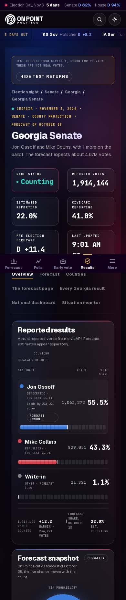 | Stacked mobile layout: status pill, wrapped badges, scrollable map-mode pills, candidate rows with forecast ticks |
| Flagship Senate, partial count | 768 dark | 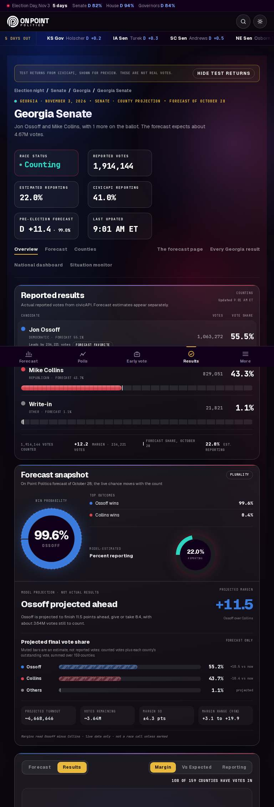 | Two-column meta; map and candidate table stacked |
| Flagship Senate, partial count | 1024 dark | 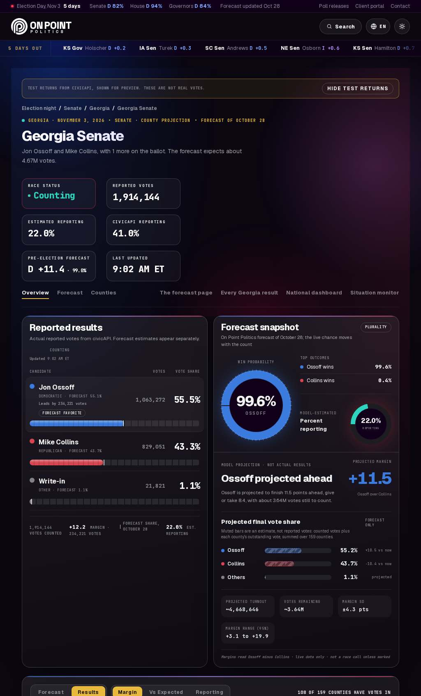 | Map and candidate panel side by side; projection zone beside toplines |
| Flagship Senate, partial count | 1280 dark | 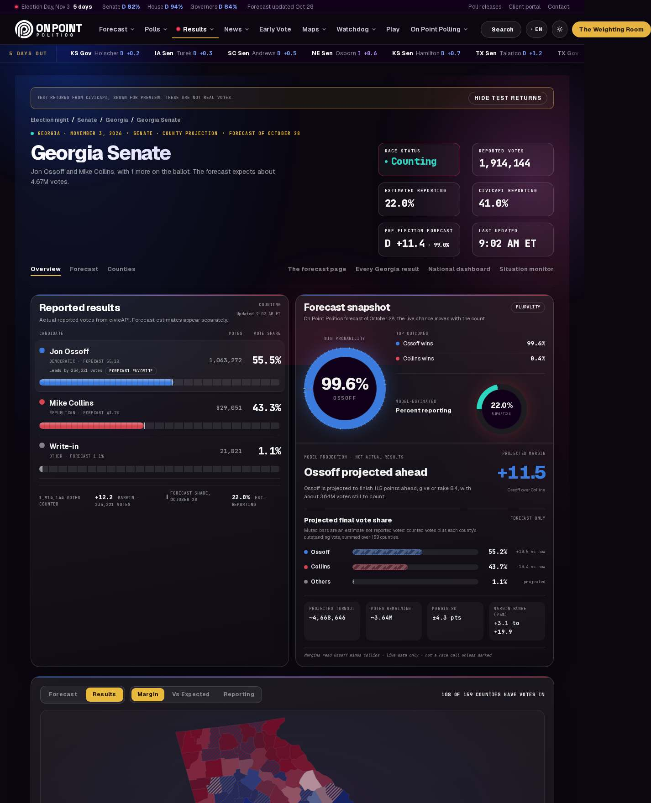 | Desktop reference: status *Counting*, 51 hatched counties, expected lean hatched vs reported solid |
| Flagship Senate, partial count | 1440 dark | 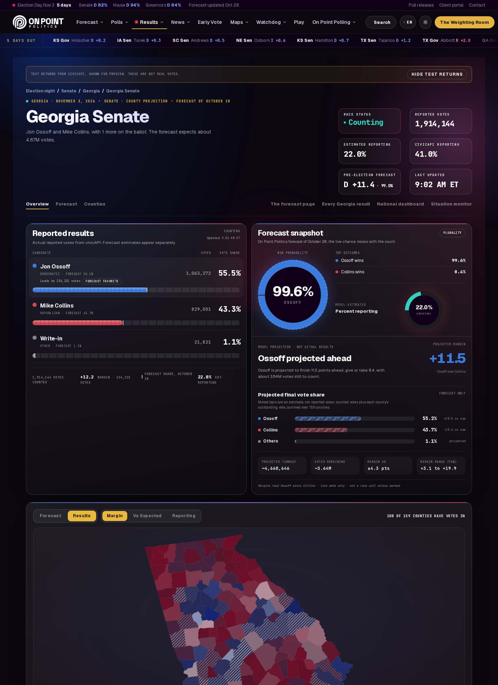 | Wide layout; no overflow |
| Flagship Senate, partial count | 1280 light | 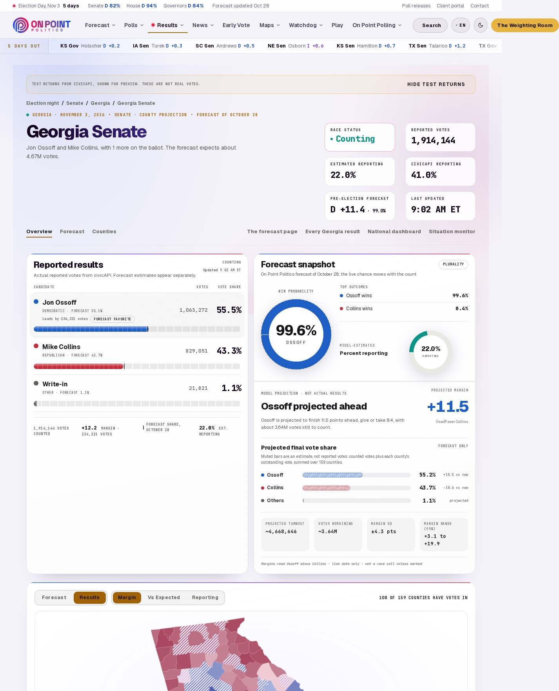 | Professional Light theme; status, badges and map legend remain legible |
| Flagship Senate, partial count | 390 light | 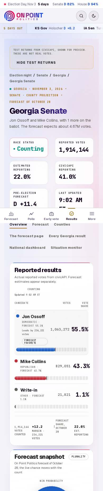 | Light theme on mobile |
| Senate, race called | 1280 dark | 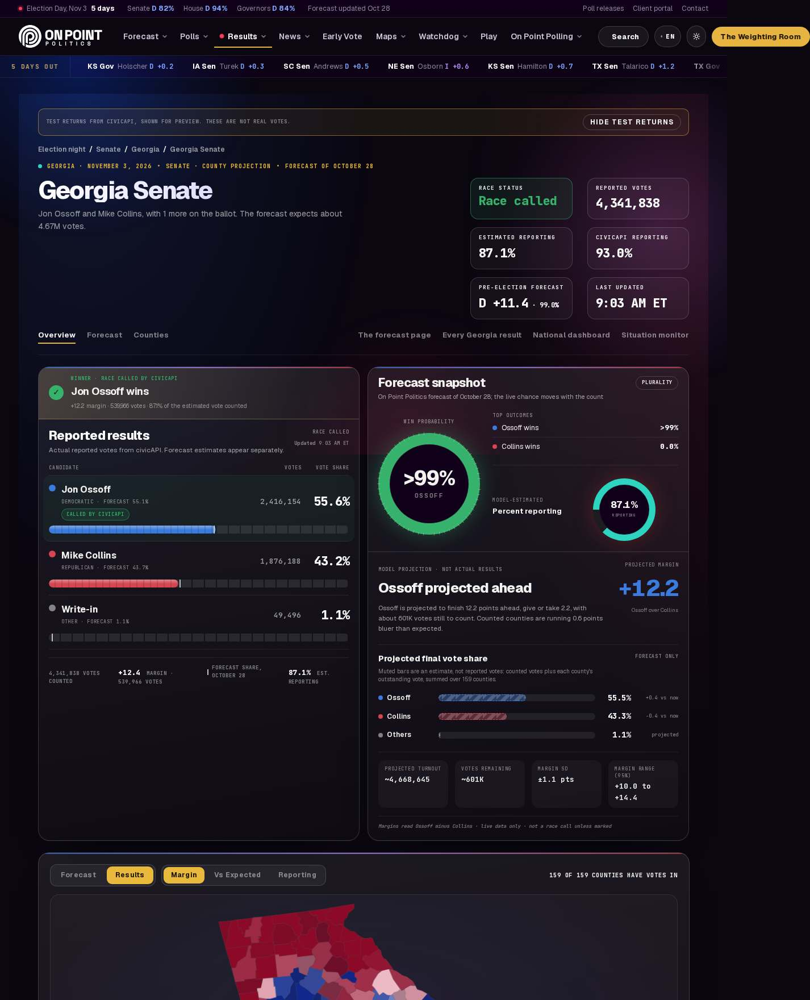 | Green *Race called by civicAPI* band, status *Race called*, favorite/leads badges suppressed; the projection panel stays labelled *Model projection · not actual results* |
| Senate, OnPoint projection | 1280 dark | 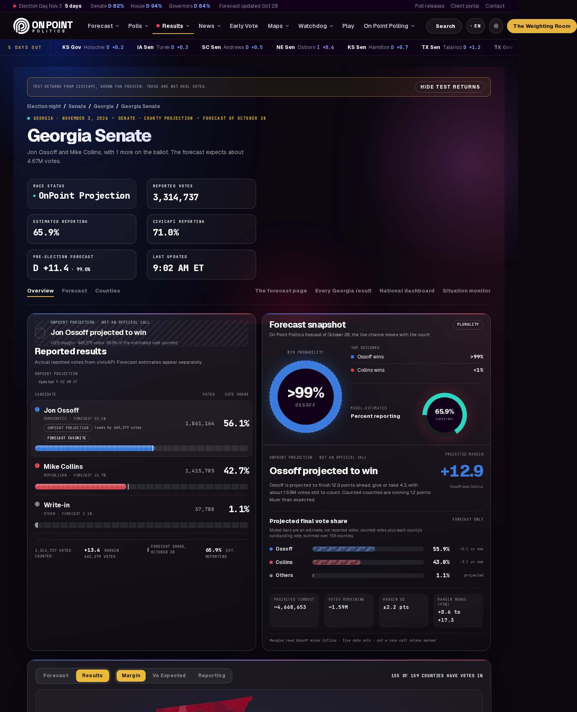 | Dashed *OnPoint Projection* status and chip, visually distinct from an official call |
| Senate, no results yet | 390 dark | 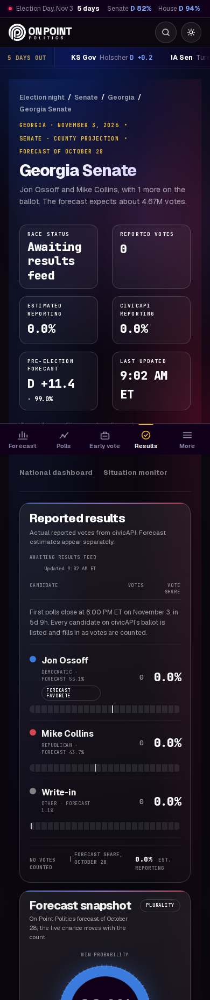 | *Awaiting results feed*; forecast-only map (159/159 hatched) |
| Governor | 390 light | 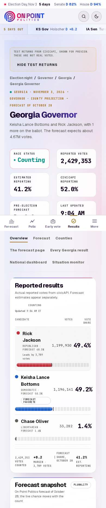 | Same grammar on mobile in the light theme |
| Governor | 1280 dark | 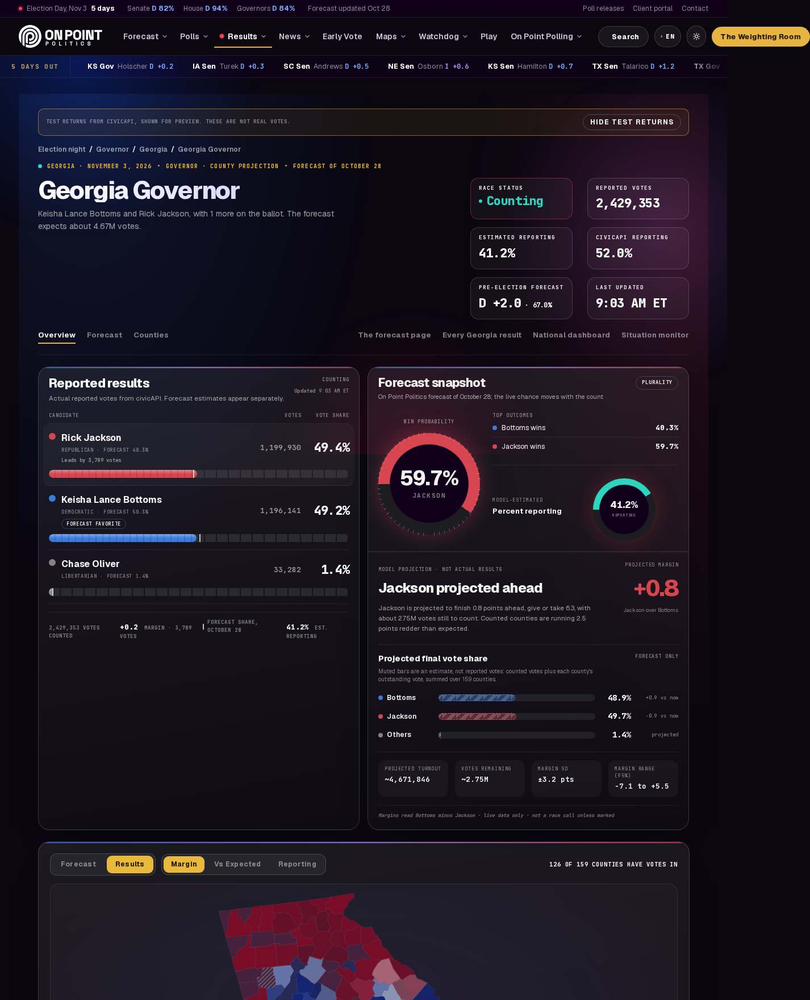 | Desktop governor page, 33 hatched counties |
| House | 390 dark | 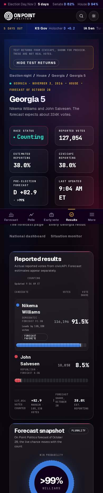 | Single district, district-scoped county map |
| Ballot measure | 1280 dark | 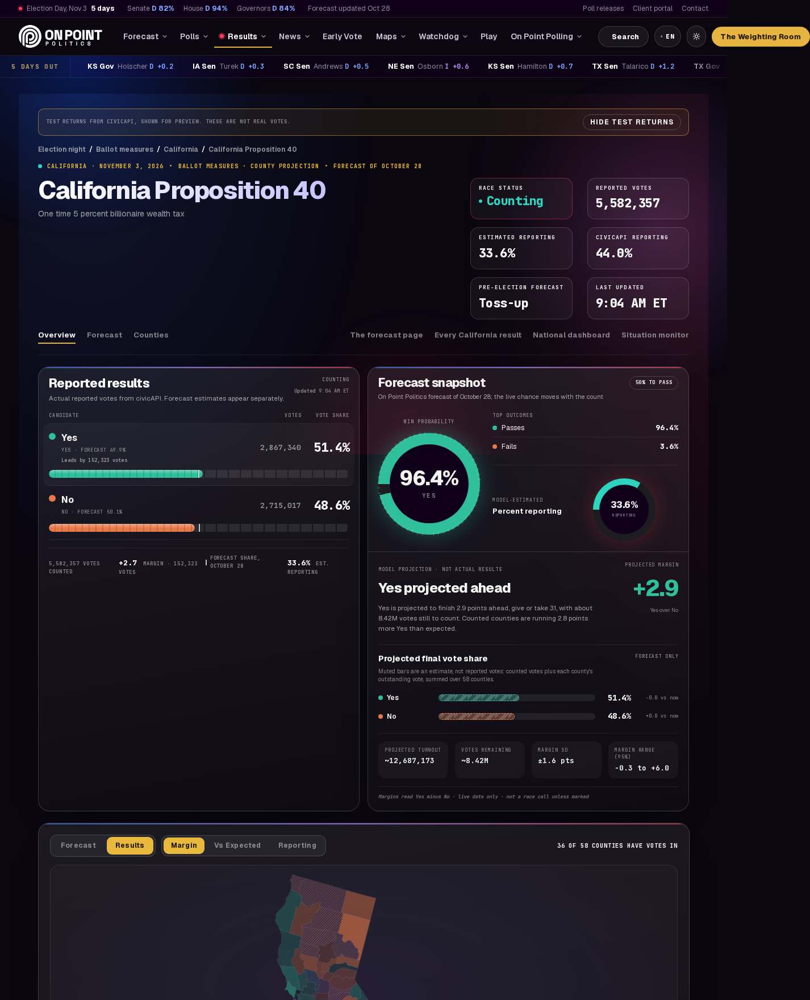 | Yes/No palette and pass-threshold pill |
| Other race, no forecast | 1280 dark | 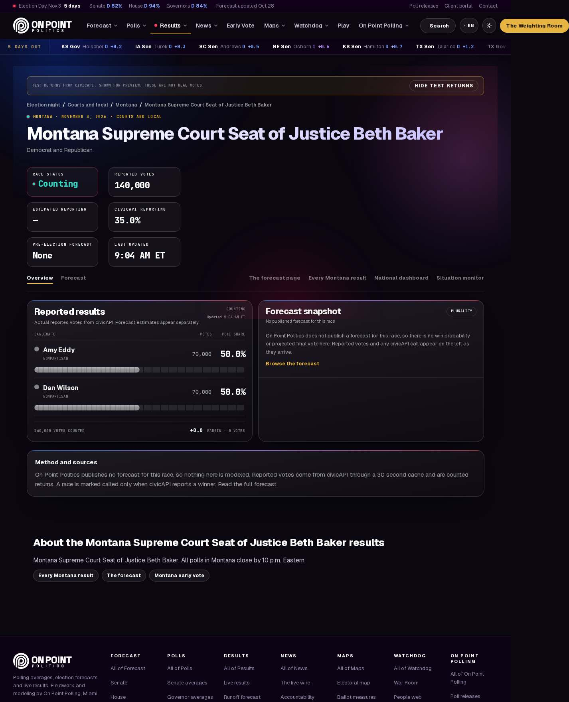 | `.nd-nofc` panel replaces the projection zone; forecast shown as *None*; raw returns only |
| State legislature, no results yet | 1280 dark | 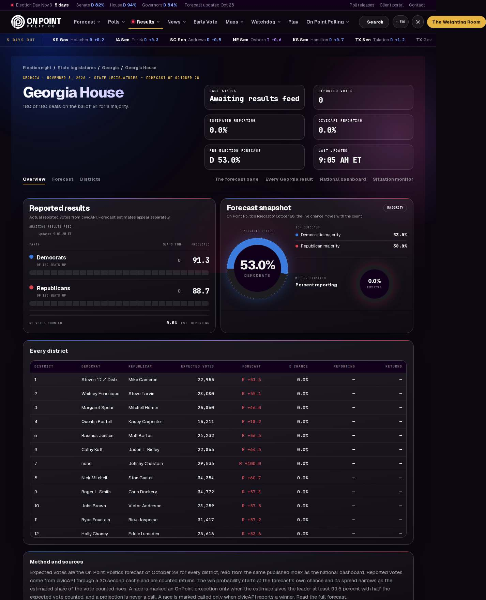 | Chamber page with no live feed |
| Feed unreachable | 1280 dark | 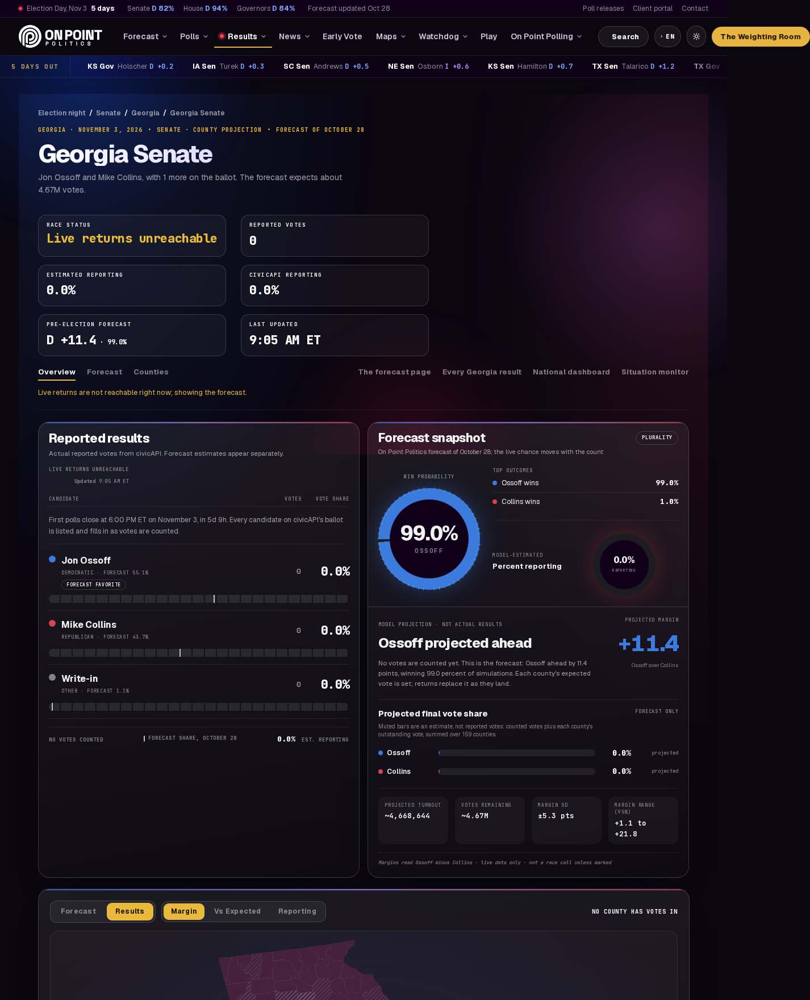 | Gold *Live returns unreachable* status, error line, forecast still rendered |

Full index (`{scenario}/{width}-{theme}.jpg`): `senate-partial` (390 dark/light, 768, 1024, 1280 dark/light, 1440), `senate-called` (390 and 1280, dark/light), `senate-pre`, `senate-projected` (390, 1280), `senate-closing`, `senate-first`, `senate-near`, `senate-complete` (1280), `gov-partial` and `measure-partial` (390 and 1280, dark/light), `gov-close`, `house-partial`, `other-partial`, `leg-pre`, `national` (390, 1280), `state-partial` and `feed-down` (1280).

### Visual QA review (close-out)

Eleven post-fix screenshots were inspected: `senate-partial` at 390 / 768 / 1024 / 1280 / 1440 dark and 1280 light, `gov-partial` 390 light, `measure-partial` 1280 dark, `other-partial` 1280 dark, `senate-called` 1280 dark and `house-partial` 390 dark. Findings: no overlap, clipped text, contrast failure or horizontal overflow attributable to this page, and the status pill, call band and projection label are consistent with the national dashboard. No code changes were needed. Minor observations, deliberately left as they are:

- At 1024 and wider, the *Reported results* card stretches to the height of the projection column, leaving empty space under the candidate rows (also visible on the ballot-measure page).
- The *Counting / Updated* header block wraps onto two lines at 390 and 1024.
- The pre-existing forecast outcome rows read `{Candidate} wins 99.6%` inside the *Model projection · not actual results* panel; they are probabilities, not results, and are unchanged by this work.
- The fixed bottom tab bar appearing mid-page in full-page mobile captures is a screenshot-stitching artifact, not a layout fault.

### Final QA pass (Milestone 2 close-out, 2026-10-30)

A second, independent inspection of eleven shots — `senate-partial` 390 / 768 / 1024 / 1280 / 1440 dark and 1280 light, `gov-partial` 390 light, `house-partial` 390 dark, `measure-partial` 1280 dark, `other-partial` 1280 dark, `senate-called` 1280 dark — confirmed the findings above. Composition, type scale, meta-block grid, tab row, card chrome and map legend match the national dashboard and the rest of the OnPoint results UI in both themes; official calls (green band + *Called by civicAPI* chip), OnPoint projections (dashed status + chip) and reported returns (solid bars, *Reported results* card) stay visually distinct in every state captured. No code change was made. Two further minor observations, left as they are:

- At 390 the *Last updated* value (`9:04 AM ET`) and the *Pre-election forecast* value (`D +82.9 · >99%`) wrap to two lines inside their meta blocks. Text is complete and legible; the only effect is that those two blocks are taller than their neighbours.
- On the no-forecast page (`other-partial`) the *Forecast snapshot* card keeps its race-rule chip (*Plurality*) and, at 1024 and wider, stretches to the height of the results card below the `.nd-nofc` panel.

## 8. Verified result states

| # | State (brief §11) | Scenario | How it was produced | What the page shows |
|---|---|---|---|---|
| 1 | Pre-election, feed empty | `senate-pre` | civic search returns `[]` | status *Awaiting results feed*; forecast favorite badge; forecast map hatched (159/159 counties lean-only) |
| 2 | Polls open, race listed, 0% | `senate-closing` | fixture `pr:0`, no votes | status *Polls open*; countdown copy in the results card; projection zone reads the pure forecast |
| 3 | First returns | `senate-first` | `pr:3`, swing +1.5 | *Counting* with live dot; *Leads by 13,917 votes*; 117 counties still hatched |
| 4 | Partial count | `senate-partial` | `pr:41`, swing −0.8 | flagship; all five widths + light; 51 hatched; forecast ticks on bars |
| 5 | Close race | `gov-close` | gov-GA `pr:78`, swing +1.6 | win probability 56.3%; *Leads by 16,182*; no projection |
| 6 | OnPoint projection | `senate-projected` | `pr:71`, swing −2 | status *OnPoint Projection* (dashed), `CallBand kind=projected`, *OnPoint projection* chip, ring >99% |
| 7 | civicAPI call | `senate-called` | `pr:93`, `winner:A` | status *Race called*, `CallBand kind=official`, *Called by civicAPI*; favorite/leads badges suppressed |
| 8 | Near-complete, no call | `senate-near` | `pr:97` | projection holds; 0 hatched |
| 9 | Complete | `senate-complete` | `pr:100`, winner, all counties | 159/159 counties solid; status *Race called* |
| 10 | Governor | `gov-partial` | `pr:52`, swing +2.2 | same grammar, ring 59.7%; dark + light |
| 11 | House | `house-partial` | GA-05 `pr:38` | district-scoped county map; ring >99% |
| 12 | Ballot measure | `measure-partial` | CA Prop 40 `pr:44`, swing −3 | Yes/No palette, pass/fail favourite label from `pPass` (*Toss-up* when p≈50%); pass-threshold pill |
| 13 | State / legislative / other | `state-partial`, `leg-pre`, `other-partial` | agri-GA `pr:60`; sl-GA-house empty; MI Supreme Court `pr:35` | state exec normal; chamber page shows seats + district table, no dial; court race shows `.nd-nofc` panel, *None* forecast, raw returns |
| 14 | Feed unreachable | `feed-down` | proxy requests fail (`ConnectionRefused`) | status *Live returns unreachable* (gold), `.nd-err` line, forecast still rendered, map lean-only |

Also captured: `national` (`/results/2026`) at 390/1280 to confirm the dashboard this page links back to is intact.

## 9. Validation

| Check | Command | Result |
|---|---|---|
| TypeScript | `npx tsc --noEmit` | 0 errors from this branch's files. The only errors are the two `Cannot find module` errors in the uncommitted local `flightrecorder` route (see integration doc) and one error in `.next/dev/types/validator.ts`, a git-ignored file left by an earlier dev-server run (regenerated on the next `next dev`/`build`). |
| ESLint (changed file) | `npx eslint app/results/2026/NightDesk.tsx` | 5 errors + 1 warning, all `react-hooks/set-state-in-effect` / unused-disable and all present in the file before this work (original: 6 errors + 2 warnings; one `no-unescaped-entities` error and one unused-var warning were fixed). |
| National tally | `node scripts/test-national-tally.mjs` | pass ("all checks passed") |
| Result clarity | `node scripts/test-result-clarity.mjs` | pass (node:test, 0 failures) |
| Production build | `npm run build` (`next build --webpack`) | exit 0, 4,546 pages (run before the documentation-only close-out; not re-run, since no application code changed afterwards) |
| Horizontal overflow | probe on every shot | 0 at 390/768/1024/1440. At 1280 every page (including `/results/2026`) reports `div.right / a.btn.gold @1426`: the sitewide masthead's right cluster, the known P1 in the sitewide audit, not this page. |

## 10. Preserved pre-existing issues (not fixed on purpose)

- `NightDesk.tsx` eslint: 5× `react-hooks/set-state-in-effect` and one unused-disable warning, identical to the file before this work. Fixing them means restructuring `useLive`/view sync, which is shared behaviour — out of scope.
- 1280px masthead P1 noted in [ONPOINT_SITEWIDE_UI_AUDIT.md](ONPOINT_SITEWIDE_UI_AUDIT.md) is sitewide chrome, not this page.
- `middleware` deprecation warning from Next 16 is sitewide.

## 11. Future Race History placement

The intelligence branch's Race History / flight-recorder timeline should mount at the `#nd-history` comment in `NightDesk.tsx`, directly below the projection zone and above the county section, full width of the right column on desktop and after the candidate table on mobile. It should read the same `statusKey` so its headline matches the status pill.

## 12. Remaining work / recommended next milestone

- `origin/main` has moved on to `45df156c` (four Oct 29 forecast/poll commits after `30ecde03`). None of them touch `app/results/**` or these docs, so the branch merges cleanly; fold the newer head in with the same no-fast-forward procedure before this branch is merged, so the page is tested against Lester's current published numbers.
- Wire the Race History module once `feature/election-night-intelligence-v1` lands (see §11).
- Senate/governor "needs" ticker (votes outstanding vs. lead) once civicAPI exposes expected-vote by county.
- Share card (`/api/og`) per race using the status pill colours.
- A real-returns dry run against the civicAPI test feed on the first `?test=1` window, to confirm the status pill transitions in order.
